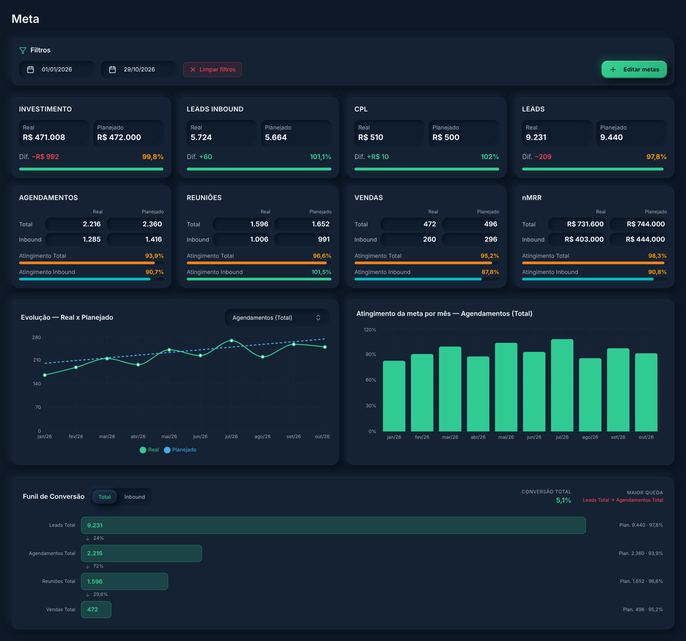

# Companium · Metas da Captação

Protótipo da tela **Captação › Metas** do [Companium](https://github.com/Felipe-Satler/companium), a plataforma interna de analytics e operação que desenvolvi na **Groohub**. Ela acompanha, mês a mês, as metas da mídia própria da agência contra o realizado, do investimento até o novo MRR.



> Todos os números são fictícios, gerados no próprio código. Esta versão não se conecta a nenhum banco.

## Funcionalidades

- **KPIs real × planejado** de investimento, leads, leads inbound, CPL, agendamentos, reuniões, vendas e nMRR, com diferença e percentual de atingimento.
- **Visão total e inbound** para agendamentos, reuniões, vendas e nMRR.
- **Cores por atingimento**: verde a partir de 100%, âmbar entre 80% e 99%, vermelho abaixo disso.
- **Evolução mensal** de qualquer indicador e gráfico de atingimento da meta por mês.
- **Funil de conversão** de leads até vendas, com a taxa de cada etapa e a maior queda destacada.
- **Filtro por período** e diálogo para cadastrar ou atualizar as metas de vários meses de uma vez.

## Stack

React 19, TypeScript, TanStack Start, Vite, Tailwind, shadcn/ui, Recharts e date-fns. No Companium, os dados vêm de uma tabela de metas no Supabase; aqui o hook `useCaptacaoMetas` gera dados de exemplo em memória.

## Rodando localmente

```bash
npm install
npm run dev
```

## Como foi feito

A tela foi construída no Lovable e depois levada para o Companium. A definição dos indicadores e das regras de atingimento, a validação e os testes de cada funcionalidade foram feitos por mim.

---

Desenvolvido por **Felipe Satler** · Groohub, 2026
